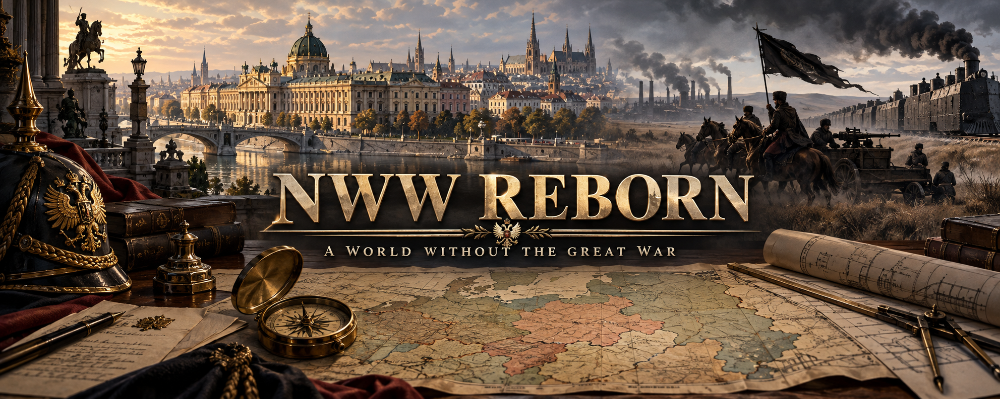

# NWW Reborn



**Первая мировая война не началась. Старые империи сохранились, но их внутренние противоречия никуда не исчезли.**

NWW Reborn — модификация для **Hearts of Iron IV 1.19.3** с альтернативной кампанией 1936 года. Здесь политические кризисы, национальные движения и борьба за промышленность определяют, кто переживёт следующий большой конфликт.

## Мир к 1936 году

Июльский кризис 1914 года завершился дипломатическим соглашением. Германия сохранила кайзера и заморские владения. Османская династия удержалась у власти и ищет путь возвращения на Балканы. Дунайская монархия распалась под давлением собственных противоречий, оставив Вене задачу нового объединения коронных земель.

Российскую империю разрушила **Великая смута 1918–1922 годов**: земельный вопрос, продовольственный кризис, промышленные конфликты и провал конституционного компромисса. Революция произошла без мировой войны. На западе бывшей империи появились Советская Украина, Литовско-Белорусский Союз и Вольная территория Махно.

## Страны и реализованные механики

| Страна | Содержание кампании |
| --- | --- |
| **Литва-Беларусь — LTB** | Виленский компромисс или распад Союза; политические пути с подготовкой и поддержкой партии; собственные предприятия, штаб и последовательное преодоление стартовых проблем. |
| **Махновщина — MKN** | Преемники Батьки, баланс штаба и вольных советов, кризис с дедлайном, гражданская война между властью и сильнейшей оппозицией, пограничная эскалация и развитие коммун. |
| **Советская Украина — UKR** | Собственное дерево, политические мандаты, промышленная реконструкция и дипломатия с соседями через согласие или отказ. |
| **Советская Россия — SOV** | Своя история революции, поэтапная реформа государства, экономики и армии; западное давление с 1939 года и подготовленный исторический выход к войне в 1940-м. |
| **Австрия — AUS** | **159 игровых фокусов**: пять политических маршрутов, восстановление Австро-Венгрии, территориальные ультиматумы, соперничество с Германией и кризис Богемии. |
| **Османская империя — TUR** | Платные последовательные переговоры с советами и династический балканский маршрут: Болгария, Греция, дальнейшее давление в регионе. |
| **Германская империя — GER** | Кризис наследования, четыре политических пути, борьба за устройство империи и сохранённые заморские владения. |
| **Франция — FRA** | **146 фокусов**: четыре основные политические ветки, мандат кабинета и уличная напряжённость, региональный заморский договор, модернизация промышленности и вооружённых сил; собственные панели решений и эмблемы. |

Венгрия и Афганистан также используют адаптированный контент старого NWW. Масштаб деревьев различается; другие страны продолжают разрабатываться.

### Литва-Беларусь: сохранить Союз

Виленский компромисс прекращает кризис и открывает мирное развитие. Исторический ИИ выбирает его вторым фокусом. При сохранённом Союзе избыточный кризисный фокус пропускается без повторного запуска распада.

Реорганизация армии требует компромисса и разрешения кризиса. Политические переходы требуют подготовки и **не менее 40% поддержки** соответствующей партии. Половина дерева — 48 из 96 фокусов — занимает 70 дней: объединённый минимальный маршрут через основные стартовые штрафы рассчитан до августа 1938 года.

### Махновщина: преемники, коммуны и граница

После смерти Махно начинается **180-дневный срок** для политического урегулирования. Четыре направления представляют анархо-милитаристов, анархо-коммунистов, аграрных изоляционистов и государственных синдикалистов. У каждого есть свои советники и политические институты. При срыве урегулирования власть сражается с одной сильнейшей оппозиционной фракцией; игрок выбирает сторону через решения.

Пограничный кризис с Советской Украиной открывается событием. Напряжённость пассивно растёт каждые **30 дней**. Отвод дозоров занимает **20 дней** и снижает её на один уровень после завершения действия. Победа в пограничном конфликте передаёт и интегрирует конкретный спорный регион. Киев исключён из таких целей; советские Сталино, Харьков и Крым доступны после подготовки донбасской агитации и при наличии общей границы. Окружение Киева в полноценной войне может вызвать капитуляцию Советской Украины.

После полного присоединения стартовых земель Украины открывается скрытая ветка из восьми фокусов региональных хартий и восстановления. Для ИИ доступны исторический, случайный и четыре явных политических курса; союзников защищают общие дипломатические ограничения. [Украинская интеграция и исправления](docs/MKN_ukraine_followup.md).

Промышленность предлагает два взаимоисключающих пути по 10 фокусов: Днепрострой (525 дней) и вольные кооперативы (490 дней). Пять решений хозяйственного конгресса и девять региональных проектов на 60 дней переносят часть развития на карту. [Подробности хозяйственной переработки](docs/MKN_economy_refactor.md).

Промышленность и каждая военная служба развивают собственный постоянный дух. Есть специализированные предприятия и MIO, тачанки, бронепоезда, железнодорожная артиллерия, подготовка командиров, экспроприации и международная деятельность.

35 военных фокусов требуют подготовки: техники, исследований и опыта. После каждой из 30 крупных реформ действует общий 90-дневный перерыв перед следующей реформой. Общая ветка от ухода Батьки развивает добровольный Чёрный Интернационал, внешние представительства и технические соглашения. Дополнительные ветки охватывают зарубежный Набат, отчаянную оборону против мажора и общую научную программу после промышленности с реакторным проектом в Гуляйполе. Обе промышленные ветки выходят через вольные мастерские к единой цепочке институтов; общая наука даёт пять ячеек исследований, а Киевский научный обмен после интеграции Украины — шестую. Украинское нападение проходит через завершённую пограничную эскалацию; украинский ИИ ведёт эту кампанию без призыва союзников. [Врата прогресса и новые ветки](docs/MKN_progress_gates_and_horizons.md).

### Австрия: корона и коронные земли

В 1936 году Австрией правит **Отто I Габсбург**. Исторический путь сохраняет кайзера и абсолютизм. Альтернативы — конституционная монархия, национальная директория, рабочая республика или новая династия Лихтенштейнов. Каждый путь получает подготовку, собственные учреждения и политические последствия.

Общая внешняя политика доступна при любом из пяти режимов: венгерская и хорватская кампании, восстановление Австро-Венгрии, требования Галиции у Польши и Буковины у Румынии, затем борьба за влияние в Центральной Европе. Получатель ультиматума выбирает уступку или отказ. Полное включение Венгрии и Хорватии по военной кампании требует их действительной капитуляции перед Австрией.

**«Богемия желает отделиться»** — отдельная система напряжённости от 0 до 10. Каждый месяц она растёт; переговоры и инвестиции снижают её за время и политическую власть. На пределе Богемия провозглашает независимость. Долгосрочное решение проходит через языковую хартию, представительство, бюджетные соглашения и договор коронных земель.

Гражданская промышленность, военное производство и технологии разделены. Армия, авиация и флот имеют собственные программы развития; предусмотрены местные концерны, MIO, советники и командиры.

## Установка и начало кампании

1. Поместите папку `nwwreborn` в `Documents/Paradox Interactive/Hearts of Iron IV/mod/`.
2. Файл запуска `nwwreborn.mod` должен находиться в папке `mod`, рядом с каталогом проекта. Его путь должен указывать на `mod/nwwreborn`.
3. Добавьте NWW Reborn в набор модов Paradox Launcher и начните кампанию **1936 года**.

Основные тексты доступны на русском и английском. Функции DLC, включая MIO и конструкторы техники, включаются при наличии соответствующего дополнения. После крупных изменений карты или политических систем предпочтительна новая кампания. Совместимость с другими модами, меняющими карту, страны или деревья фокусов, отдельно не гарантируется.

## Разработка и проверки

Страновой контент разделён по файлам: фокусы, идеи, события, решения и эффекты. Старый мод находится в `old-mod/noworldwarzhive`; его идеи адаптируются к текущему лору и движку. Скрытые определения совместимости с DLC не входят в заявленное число игровых фокусов Австрии.

Основные проверки из корня проекта:

```powershell
python tools/validate_country_content.py --game "D:/Steam/steamapps/common/Hearts of Iron IV"
python tools/validate_legacy_content.py --game "D:/Steam/steamapps/common/Hearts of Iron IV"
python tools/validate_france_content.py --game "D:/Steam/steamapps/common/Hearts of Iron IV"
python tools/test_france_lifecycle.py
python tools/validate_austria_campaigns.py
python tools/validate_austria_overhaul.py --game "D:/Steam/steamapps/common/Hearts of Iron IV"
git diff --check
```

Статические проверки проверяют ссылки, синтаксис и сценарии скриптов. Поведение интерфейса, ИИ и войн дополнительно проверяется в новой кампании по свежему `error.log`.

Подробности: [Австрия](docs/AUS_overhaul.md), [советский лор](docs/SOV_lore_and_design.md), [темп LTB](docs/LTB_pacing.md), [механики МКН](docs/MKN_overhaul_completion.md), [политика Германии](docs/GER_political_framework.md).

Обложка создана через imagegen специально для проекта. [Промпт](docs/art/readme/prompt.txt) и [оригинал изображения](docs/art/readme/nww-reborn-cover.png) сохранены в репозитории.
