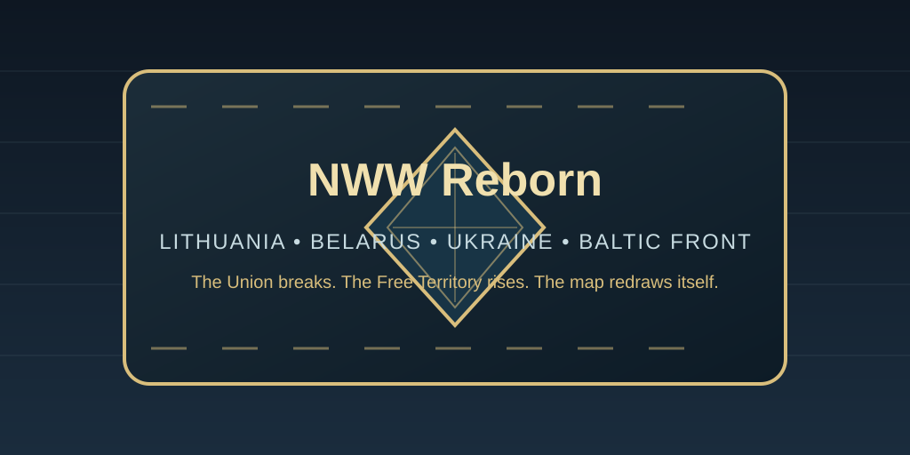

# NWW Reborn



> _"The guns of August 1914 never fired. Yet peace did not save the old world — it merely condemned it to rot from the inside."_

**NWW Reborn** is a focused, lore-driven alternate-history modification for _Hearts of Iron IV_. It explores a world where the July Crisis of 1914 was resolved through diplomatic compromise. Without the slaughter of the Western Front, the great empires avoided catastrophic defeat, but could not outrun time.

By 1936, the Russian Empire has collapsed in a prolonged, chaotic internal revolution. In the fractured frontier between Kaiser Germany and the Soviet borderlands, new and fragile experiments have taken root: the precarious dual-state of the **Lithuanian-Belarusian Union**, and the stateless agrarian anomaly of the **Makhnovist Free Territory**.

Here, borders are arguments, legitimacy is forged on the railways, and the next great war will not be decided in imperial palaces, but in the muddy trenches, forests, and steppes of Eastern Europe.

---

## The World of 1936

- **The Kaiser's Hegemony:** Imperial Germany stands intact and unchallenged externally, yet its _Mitteleuropa_ sphere is strained by economic exhaustion and rising local nationalism.
- **The Eurasian Fracture:** The Russian Empire disintegrated between 1918 and 1922 during the "Great Tumult". The Bolsheviks secured core industrial centers, but failed to tame the western borderlands and the southern steppes.
- **The Danubian Dissolution:** The Austro-Hungarian Dual Monarchy decayed peacefully throughout the 1920s. Austria remains a formidable Alpine power, Hungary boils with irredentist bitterness, and Croatia stands proudly independent.
- **The LitBel Compromise:** Established under German supervision as a buffer against revolution, the **Lithuanian-Belarusian Union (LTB)** is a fragile hybrid state paralyzed by ethnic rivalry between Kaunas and Minsk.
- **The Steppe Experiment:** In southern Ukraine, the **Free Territory (Makhnovshchina)** has defied all odds, surviving on peasant goodwill, armored trains, and insurgent cavalry. But the revolution's golden age has ended.

---

## Main Theatres of Conflict

### 1. Makhnovist Ukraine: The Crucible of Huliaipole

The Free Territory is not a nation — it is an armed, decentralized network of peasant soviets, workers' communes, and insurgent detachments held together by the legendary authority of **Nestor Makhno**.

By 1936, the experiment faces an existential crossroads:

- **The Decaying Batko:** Makhno is severely afflicted by tuberculosis. As his health falters, the country suffers crippling penalties to stability, political power, and military cohesion.
- **The Crisis of 1936:** Sometime between **May 1, 1936 and January 1, 1937**, a random event triggers: _The Batko's Final Breath_. Makhno departs or succumbs to illness, instantly activating a **180-day countdown to a four-way fratricidal civil war**.
- **Balance of Power (BoP):** Manage the bitter tug-of-war between the **Emergency Military Staff** (centralization, iron discipline, offensive power) and the **Free Soviets** (grassroots democracy, militia defense, local autonomy).
- **Cult of Railway Warfare:** Dominate the wide steppes with customized warfare:
  - **Armored Trains:** Massively reduced production cost (-35%) and accelerated assembly.
  - **Railway Artillery:** Rapid deployment and brutal +25% shore/field bombardment.
  - **Tachankas:** Lightning-fast cavalry and motorized formations built for devastating steppe maneuvers.

#### The Four Destinies of the Steppe

Players must race against the 180-day countdown to complete a faction-specific **lifesaver focus**, averting collapse:

1. **The Black Dictatorship (Anarcho-Militarism / Fascism):** Discard ideological purity for raw survival. Purge the pacifists, standardize production, and unleash _The Black Horde_ upon Lithuania-Belarus and the Soviets.
2. **The True Utopia (Anarcho-Communism / Democratic):** Uphold Kropotkin’s purest vision. Abolish the officer corps, empower worker-peasant assemblies, export revolution through foreign subversion, and build an impenetrable _Stateless Bastion_.
3. **The Wild Field (Agrarian Isolationism / Non-Aligned):** Sever ties with corrupt industrial cities. Fortify every farmhouse, dynamite railway bridges upon retreat, and turn the breadbasket into a poisonous trap for foreign invaders.
4. **The Red Compromise (State Socialism / Communism):** Strike a desperate bargain with Soviet Russia and Soviet Ukraine. Integrate industrial networks and military command — while praying the Bolsheviks do not slip a dagger into your back once more.

---

### 2. The Lithuanian-Belarusian Union (LitBel)

Occupying the crucial corridor between Central Europe and Russia, the Union is an unstable confederation on the brink of divorce:

- **The Ethnic Duel:** Balance parliamentary influence between Lithuanian urban administrators and Belarusian agrarian populists.
- **Economic Sovereignty:** Wean domestic industry off the German Mark without triggering industrial paralysis.
- **Partition or Federation:** Choose whether to reinforce the fragile federal union, orchestrate a civilized split, or ignite a bitter civil war over disputed borders.

---

### 3. Soviet Borderlands & Imperial Shadows

The periphery is in constant motion:

- **Soviet Ukraine & Soviet Russia:** Eager to settle old scores with the Makhnovist "bandits" and reclaim lost western frontiers.
- **Imperial Germany:** Watching the buffer states with watchful eyes, ready to intervene should the revolution spill west.
- **The Baltic Republics:** Latvia and Estonia maneuvering between German commercial domination and Soviet revanchism.

---

## Gameplay Mechanics

- **Native Balance of Power:** Custom UI mechanics controlling internal ideological friction in the Free Territory.
- **Dynamic Crisis Missions:** High-stakes, timed missions that force players to prioritize political stability over reckless expansion.
- **Worldwide News Dispatch:** Global events informing great powers of tectonic shifts, including the historic passing of Nestor Makhno.
- **Asymmetric Warfare:** Deep buffs to local resistance, sabotage decisions, scorched earth, and mobile rail artillery rather than conventional frontline grinding.

---

## Mod Structure

```text
├── common/
│   ├── bop/               # Native Balance of Power mechanics (MKN Staff vs. Soviets)
│   ├── country_tags/      # Custom tags (MKN, LTB, etc.)
│   ├── decisions/         # BoP decisions, regional border raids, crisis countdowns
│   ├── ideas/             # Custom national spirits, tachanka/railway modifiers
│   └── national_focus/    # Custom, lore-rich political and military focus trees
├── events/                # The 1936 Crisis events, global news events, split triggers
├── history/               # 1936 OOBs, railway network placements, character setups
├── interface/             # Custom GFX definitions for focus icons and event art
└── localisation/          # Full Russian and English localization
```
