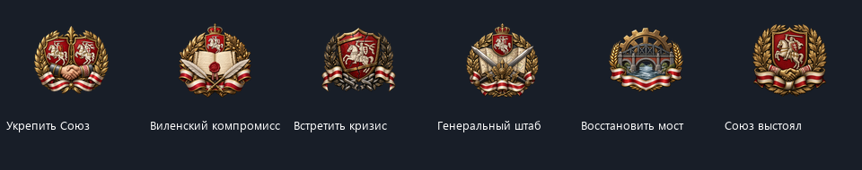

# Германские владения, МЕФО и новые иконки LTB

## Заморские земли Германии

Германии переданы 19 регионов текущей карты. Состав владений проверен по [материалам Немецкого исторического музея о колониях](https://www.dhm.de/lemo/kapitel/kaiserreich/aussenpolitik/statistische-angaben-zu-den-deutschen-kolonien), [германской колониальной политике](https://www.dhm.de/lemo/kapitel/kaiserreich/aussenpolitik/kolonialpolitik) и [материалу Бундесархива об аренде Киаочжоу](https://www.bundesarchiv.de/themen-entdecken/online-entdecken/geschichtsgalerien/die-entstehung-der-musterkolonie-kiautschou/).

| Владение | Регионы HOI4 |
| --- | --- |
| Германская Юго-Западная Африка | 541, 893, 894, 895 |
| Германская Восточная Африка | 546, 768, 769 |
| Камерун | 773 |
| Того | 777 |
| Земля Кайзера Вильгельма, архипелаг Бисмарка и Бугенвиль | 979, 737, 1070 |
| Маршалловы острова, Северные Марианские острова, Палау, Каролинские острова и Науру | 633, 646, 647, 684, 725 |
| Германское Самоа | 726 |
| Арендованная территория Циндао / Киаочжоу | 743 |

Используются существующие регионы карты, без новой нарезки провинций. Пограничные участки исторических владений, которые входят в другие большие регионы, не дают основания присоединять целиком соседние колонии. Британская Папуа, голландская Новая Гвинея, американское Самоа и Гуам сохраняют своих владельцев. Коренные национальные территории местных стран сохранены; немецких национальных территорий в колониях не добавлено. Послевоенные национальные территории Японии и Южной Африки в переданных регионах удалены.

Стартовое владение изменено в истории регионов, включая владельцев и контролёров поздних закладок. Поэтому карта требует новой кампании: ежедневный скрипт не отбирает колонии у участников текущей войны в старом сохранении. Машинный список находится в `GER_overseas_setup.json`.

## МЕФО

Из германской истории удалено добавление `GER_mefo_bills_modifier`. Эффект `nww_GER_disable_mefo` безопасно снимает действующие динамические модификаторы МЕФО и связанной экономики завоевания, все зарегистрированные ступени и духи выплаты МЕФО, а также миссию продления. Долговые счётчики и месячный прирост потребительских товаров обнуляются.

Не вызываются стандартные эффекты отмены или выплаты МЕФО: они могли бы списать политическую власть и выдать штраф за погашение. Есть отдельные хуки запуска и ежедневного восстановления Германии, ограниченные новым деревом `GER_focus`, для исправления старых сохранений.

Использованы актуальные определения `common/ideas/GER.txt`, `common/dynamic_modifiers/wuw_dynamic_modifiers.txt`, `common/decisions/GER.txt`, `common/scripted_effects/GER_scripted_effects.txt` и документация `remove_mission` установленной игры.

## Значимые фокусы LTB

Встроенным `image_gen` созданы шесть отдельных прозрачных эмблем:

- «Укрепить Союз»;
- «Виленский компромисс»;
- «Встретить кризис»;
- «Генеральный штаб Союза»;
- «Восстановить мост»;
- «Союз выстоял».

Новые DDS находятся в `gfx/interface/goals/LTB`, исходники и отдельные промпты — в `docs/art/ltb_focuses`. В `docs/art/LTB_focus_generation.json` сохранены весь набор промптов, способ генерации, исходные пути, файлы проекта и соответствия фокусам. Каждый игровой холст — 95×95, рисунок вписан в область 83×83 с прозрачными краями. Для всех шести значков зарегистрирована анимированная подсветка по шаблону `interface/goals_shine.gfx`.



## Источники ошибок

При первом просмотре текущего сеанса в логе было 441 строка. Старые массовые ошибки турецкого советника, пустых `_small` иконок и ошибочных ID событий отсутствовали. Повторялись некорректные динамические ID разведопераций и обращения от стандартных советских чисток к недоступным идеям.

В `operation_strat_effects.txt` сохранён стандартный выбор целей и подсчёт весов операций. Для проверок подготовки и числа завершённых операций выбранный токен теперь сравнивается с зарегистрированными типами, после чего проверяется конкретный буквальный ID операции. Переменная страны-цели сохраняется. Все шесть типов операций проверены по действующим `common/operations` игры.

Советская система чисток NSB приостановлена только для собственного дерева NWW `SOV_focus`: в нём нет стандартного пути паранойи и её разрешения. Герои, правительства и войска сохранены. Хуки чистят флаги и счётчики отсоединённой системы на старте и при восстановлении сохранения; стандартные деревья этим условием не затрагиваются.

Во время работы зарегистрирован новый запуск игры. Лог запуска 17:18 показал другую массовую ошибку: 266 сообщений о дробях без начального нуля в фокусах MKN и Украины. Исправлено 140 исходных значений `.5`, `.35`, `.75` и других на `0.5`, `0.35`, `0.75` без изменения числового смысла. Комментарии и строковые тексты не переписаны. Форматирующий модуль и основной валидатор теперь предотвращают возвращение такого синтаксиса.

Снимок разбора нового лога сохранён в `game_log_audit_2026-10-14_1718.json`. Во время работы игра продолжала писать лог и перезагружать базы, поэтому промежуточное число строк не является результатом отдельного чистого теста после всех изменений. Исходный журнал не очищался, счётчик ошибок искусственно не сбрасывался.

В продолжающемся сеансе найден рейд MKN на союзную Украину и ответное объявление войны при общем альянсе. Решение теперь требует несоюзного соседа, отсутствия урегулированной границы и подходящей пары собственных контролируемых приграничных регионов. Эти условия повторно проверяются при выполнении; если они успели измениться, стоимость возвращается, награды и конфликт не запускаются. Оба события объявления войны также проверяют отсутствие союзнических отношений непосредственно перед эффектом. Агрессивный путь против несоюзной Украины сохранён.

Остались сообщения установленной игры: дубли звуков и моделей, неверная привязка итальянской CRDA к стартовой линии, проверка контрольной суммы DLC, ошибки версии некоторых установленных Workshop-модов и перезагрузки баз. Проверка `dlc_load.json` показала, что в текущем наборе включён только NWW Reborn: наличие предупреждения версии Workshop-мода не означает, что он активен. Все ошибки не объявляются устранёнными без нового игрового запуска.

## Проверка

```powershell
python tools/validate_runtime_setup.py
python tools/validate_country_content.py --game "D:/Steam/steamapps/common/Hearts of Iron IV"
python tools/validate_legacy_content.py --game "D:/Steam/steamapps/common/Hearts of Iron IV"
git diff --check
```

Проверяются владельцы всех 19 колониальных регионов, исключённые чужие территории, отсутствие национальных территорий Германии в колониях, снятие МЕФО без погашения, восстановление сохранений, иконки и их прозрачные края, подсветки, действующие ID разведопераций, границы действия советского исправления и числовой синтаксис.
